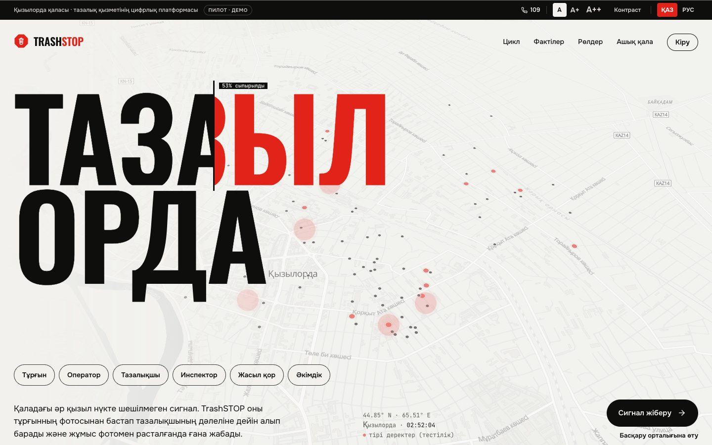
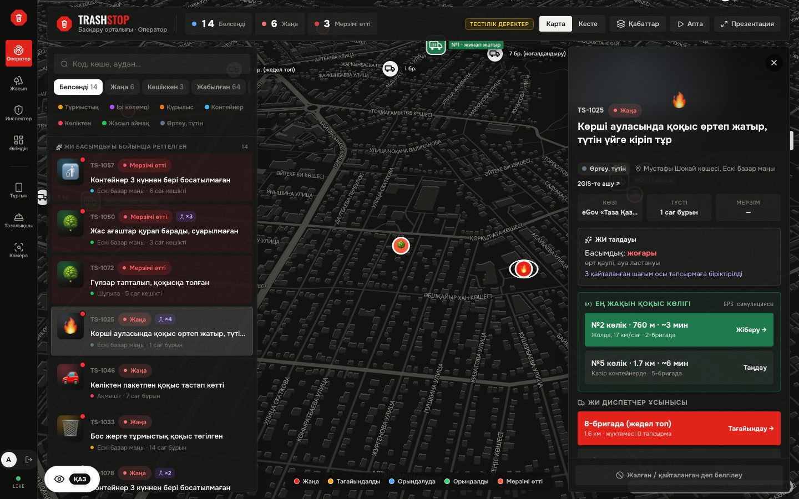
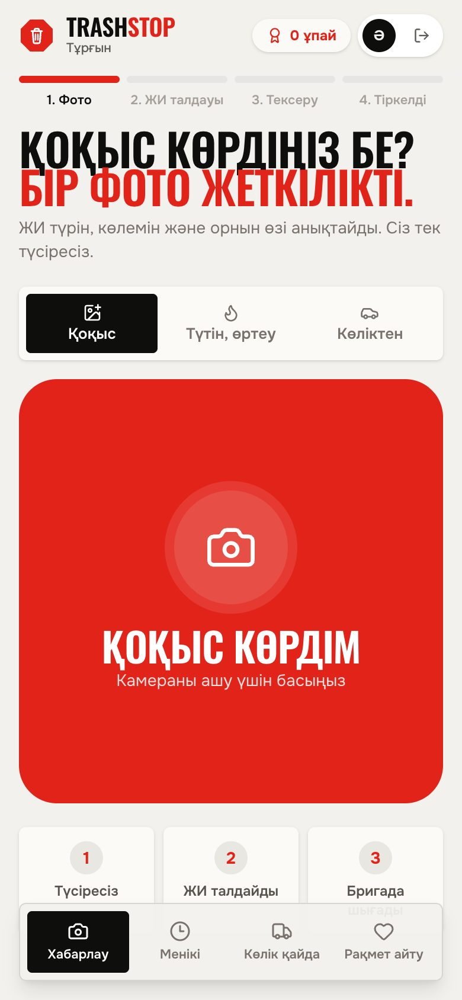
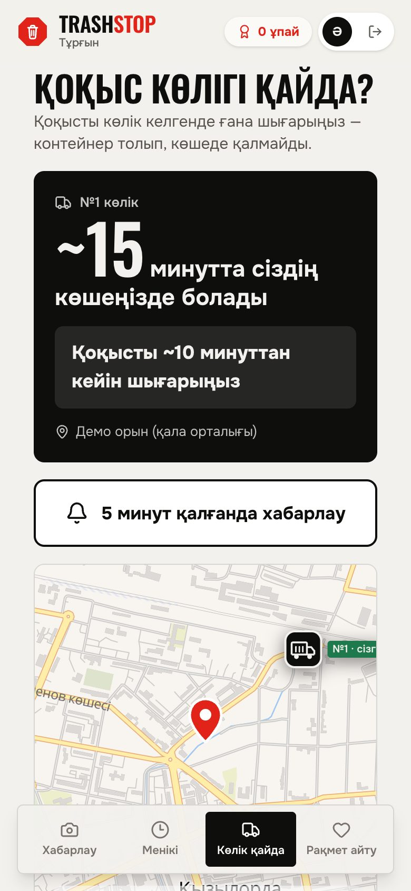
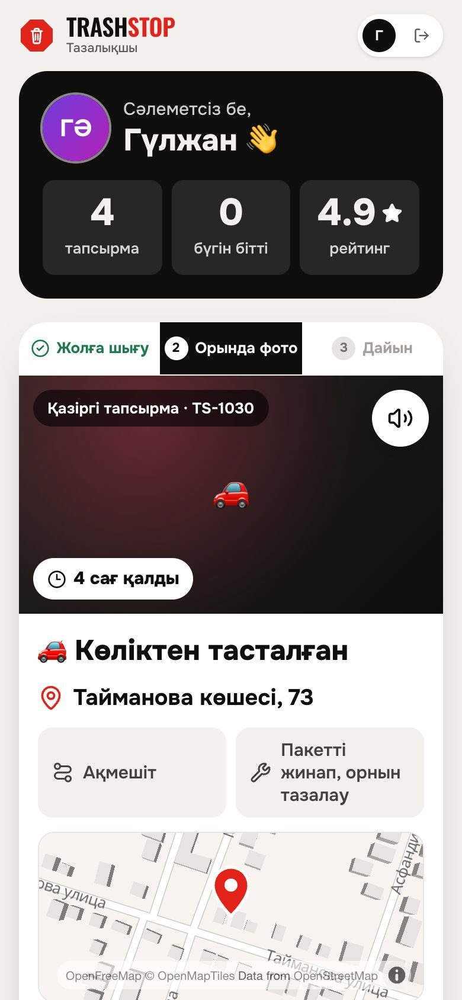
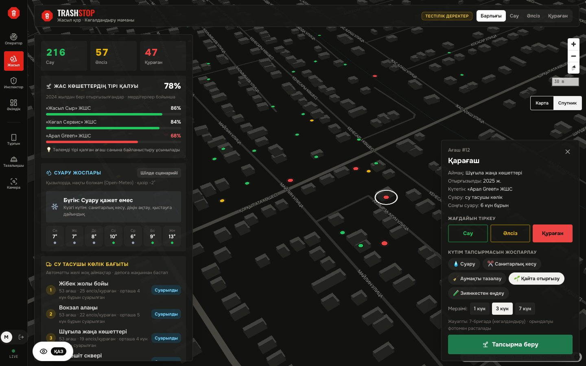
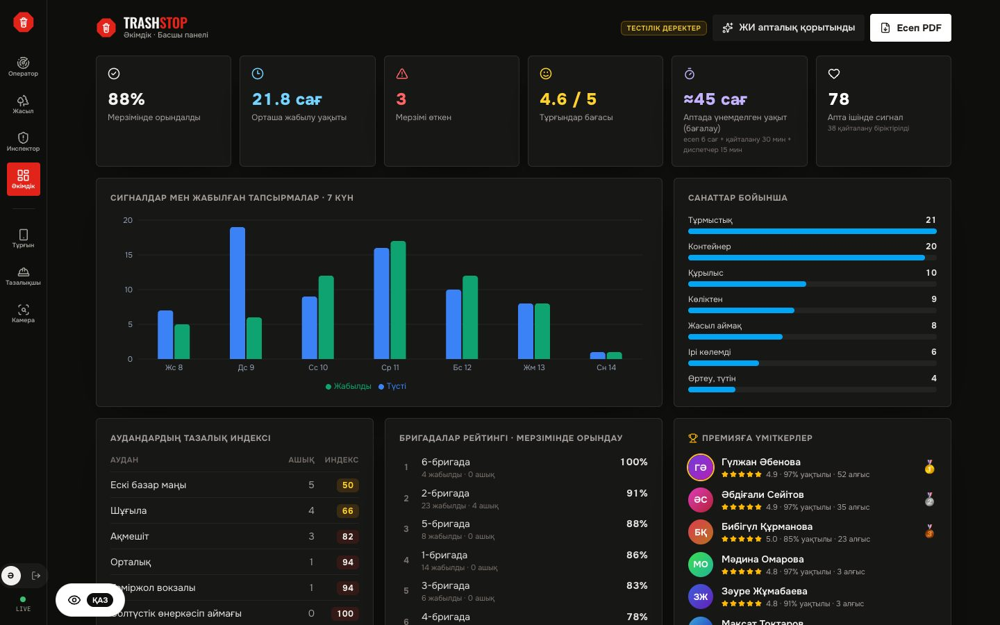

<div align="center">

# 🛑 TRASH**STOP**

### Басқалар шағым қабылдайды. TrashSTOP жұмыстың жасалғанын **дәлелдейді**.

Қызылорда қаласының тазалық пен жасыл қорды басқаратын цифрлық платформасы.<br>
Тұрғынның фотосынан тазалықшының дәлеліне дейін — толық цикл, бір картада.

**[▶ Тірі демо: trashstop.vercel.app](https://trashstop.vercel.app)**

`GovTech Hackathon 2026` · `01-кейс: Экологиялық мониторинг және жасыл қорды басқару` · `Таза Қазақстан — Таза Қызылорда`



</div>

---

## Мәселе

Қызылордада шағым қабылдайтын арналар жеткілікті: eGov, TazaQazBot, 109. Мәселе қабылдауда емес.

- **Жұмыстың шынымен жасалғанын ешкім дәлелдемейді.** Тапсырма «орындалды» деп жабылады, ал қоқыс орнында жатады.
- **Спутник үлкен қоқыс орнын көреді, ауладағы бес қапты көрмейді.** 2026 жылы облыста 53 рұқсатсыз қоқыс орны ғарыштық мониторингпен табылды, бірақ күнделікті ұсақ қоқыс көзден таса қалады.
- **Отырғызылған ағаштың тағдырын ешкім қадағаламайды.** Көшет егіледі, суарылмайды, қурайды.

## Шешім: тапсырма тек дәлелмен жабылады

```
 ТҰРҒЫН            ОПЕРАТОР            ОРЫНДАУШЫ           ТҰРҒЫН            ӘКІМДІК
 фото түсіреді  →  ең жақын көлікті →  орнында фото    →  нәтижені көріп, → бәрін бір
 ЖИ талдайды       бір басумен          түсіреді,           бағалайды         экраннан
 түбіртек алады    жібереді             ЖИ + GPS тексереді                    көреді
```

Фото оқиға орнынан 100 метрден алыс түсірілсе немесе ЖИ суреттен қоқысты көрсе, тапсырма **жабылмайды**. Жалған есеп беру мүмкін емес.



## Не істей алады

| | Мүмкіндік | Қалай жұмыс істейді |
|---|---|---|
| 📸 | **Бір фотомен шағым** | ЖИ қоқыстың түрін, көлемін (м³), қауіптілігін анықтайды. Мекенжай GPS немесе фотоның өз координатасы бойынша табылады. eOtinish үлгісіндегі нөмірлі түбіртек беріледі. |
| 🔥 | **Қоқыс өртеу, түтін** | Бөлек санат, ең жоғары басымдық, 2 сағат мерзім, жедел топқа жіберіледі. От қауіпті болса, жүйе алдымен 112-ге бағыттайды. |
| 🗺️ | **Бір ортақ карта** | Барлық арнаның шағымы мен ағаштар бір картада. Санат, мәртебе, мекенжай бойынша іздеу. Қайталанған шағымдар автоматты біріктіріледі. |
| 🚛 | **GPS бар қоқыс көліктері** | Оператор ең жақын көлікті көреді: «№2 көлік · 530 м · ~2 мин». Тұрғын «Көлік қайда?» бетінен көлік қашан келетінін біледі. |
| ✅ | **Фотомен және геоорынмен растау** | Орындаушы «кейін» фотосын түсіреді. ЖИ мен GPS сәйкес келгенде ғана тапсырма жабылады. |
| 🌳 | **Жасыл қор** | Әр ағаштың жағдайын тіркеу (сау, әлсіз, қураған), ауа райы бойынша суару жоспары, күтім тапсырмасын мерзімімен беру. |
| 🚓 | **Инспектор** | Көліктен қоқыс тастау мен өртеу істері: дәлелдер пакеті, қайталану саны, хаттама жобасы. Айыппұлды жүйе салмайды, шешімді адам қабылдайды. |
| 📊 | **Әкімдік панелі** | Мерзімінде орындау, кешіккен тапсырмалар, күтімді қажет ететін нысандар, маршрут бақылауы, экономикалық тиімділік бағасы, апталық есеп PDF. |
| 🤖 | **Көлік — қала сканері** | Қоқыс көлігіндегі камера көшені түсіреді. ЖИ қоқысты тапса, шағымды өзі ашады. Ешкім шағымданбаса да, қоқыс табылады. |
| 👵 | **Баршаға ыңғайлы** | Қазақ және орыс тілдері, ірі әріп (A++), жоғары контраст, үлкен батырмалар, тапсырманы дауыспен оқу. Телефон мен ноутбукта бірдей жұмыс істейді. |

<table>
<tr>
<td width="25%"></td>
<td width="25%"></td>
<td width="25%"></td>
<td width="25%" valign="top">

**Тұрғын:** фото, ЖИ, түбіртек.

**Көлік қайда:** келу уақыты мен хабарлама.

**Тазалықшы:** бір үлкен батырма, фотомен растау.

</td>
</tr>
</table>





## Кейс талаптарына сәйкестік

| Кейс талабы | Қай жерде |
|---|---|
| Фото, сипаттама және геонүкте арқылы өтініш беру | `/citizen` |
| Картадан санат пен мәртебе бойынша іздеу | `/ops` |
| Жауаптыны, мерзімді белгілеу және орындалуды фотомен растау | `/ops` → `/worker` |
| Ағаштар мен жасыл аймақтардың жағдайын тіркеу | `/green` → ағаш карточкасы |
| Суару, тазалау және күтім тапсырмаларын жоспарлау | `/green` |
| Ашық, кешіккен тапсырмалар мен күтімді қажет ететін нысандар панелі | `/dashboard` |

## Адал ескертулер

- **Деректер тестілік.** Шағымдар, адамдар, ағаштар ойдан жасалған және әр бетте солай белгіленген. Карта мен мекенжайлар нақты (OpenStreetMap).
- **GPS демода симуляция.** Көліктер нақты көшелермен жүреді, бірақ орындары есептелген. Кодта `FleetProvider` интерфейсі бар: мекеменің GPS жүйесіне қосылғанда тек сол бөлік ауысады.
- **ЖИ ештеңені ойдан шығармайды.** Сенімсіз немесе қолжетімсіз болса, санатты адамнан сұрайды.
- **Экономикалық тиімділік — бағалау.** Болжамдар экранда ашық көрсетілген және өзгертіледі.

## Технологиялар

| Қабат | Құрал |
|---|---|
| Интерфейс | Next.js 16 (App Router), React 19, TypeScript, Tailwind CSS 4, Motion, GSAP |
| Карта | MapLibre GL, OpenFreeMap, 3D ғимараттар, кластерлер, OSRM маршруттары |
| Жасанды интеллект | Google Gemini (көру + құрылымдалған JSON), кілттер мен модельдер арасында автоматты ауысу, нәтижелер кэші |
| Дерекқор | Neon Postgres (жолды бұғаттау арқылы қауіпсіз жазу), жергілікті режимде файл |
| Қауіпсіздік | scrypt құпиясөздері, қолтаңбалы сессия, рөлдер, сұрау жиілігін шектеу |
| Қосымша | Open-Meteo ауа райы, Nominatim/Photon мекенжай іздеу, Mobizon SMS |

## Іске қосу

```bash
git clone https://github.com/galinurislam0-svg/trashstop.git
cd trashstop
npm install
npm run build && npx next start -p 3210     # http://localhost:3210
```

`.env.local` файлы (бәрі міндетті емес, кілтсіз де демо режимде жұмыс істейді):

```bash
GEMINI_API_KEYS=кілт1,кілт2     # ЖИ талдауы (aistudio.google.com)
SESSION_SECRET=кез-келген-ұзын-жол
ADMIN_TOKEN=демо-деректерді-қайта-жасау-кілті
DATABASE_URL=postgres://...      # ортақ дерекқор (болмаса — жергілікті файл)
MOBIZON_API_KEY=...              # SMS (болмаса — код экранда көрсетіледі)
```

Кіру бетіндегі **«Демо жүргізуші»** батырмасы барлық рөлді ретімен көрсететін демо панелін ашады.

## Беттер

| Жол | Кімге |
|---|---|
| `/` | Басты бет |
| `/citizen` | Тұрғын: шағым, менің өтініштерім, көлік қайда, рақмет айту |
| `/ops` | Оператор: карта, кезек, кесте, ең жақын көлік |
| `/worker` | Орындаушы: тапсырма, фотомен растау |
| `/green` | Көгалдандыру маманы: ағаштар, суару, күтім |
| `/inspector` | Инспектор: дәлелдер пакеті, хаттама жобасы |
| `/dashboard` | Әкімдік: көрсеткіштер, есеп |
| `/truckcam` | Көлік камерасы: ЖИ сканер |
| `/track` | Өтініш нөмірі бойынша мәртебені тексеру |
| `/public` | Ашық қала беті |

---

<div align="center">

**Қызыл → Таза.** Қызылорда, 2026.

</div>
